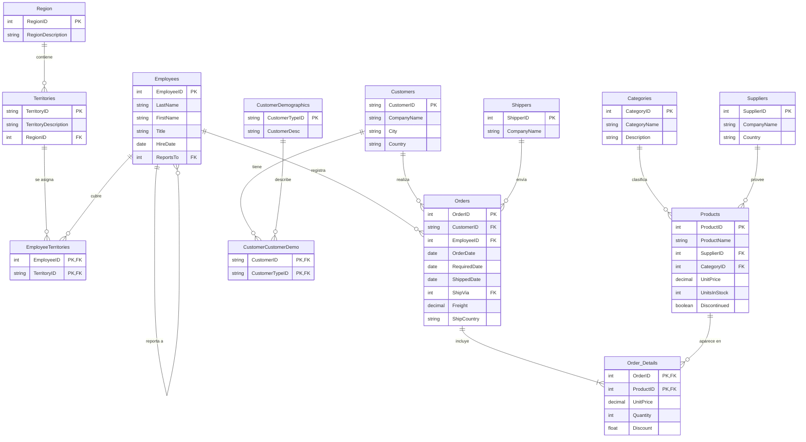

# Northwind: análisis de ventas

Proyecto de análisis de datos sobre la base de ejemplo **Northwind** con MySQL, Python y Power BI.

> **Estado: en desarrollo.** Las consultas, el notebook y el dashboard se irán añadiendo en las carpetas indicadas más abajo.

## Objetivo

Responder preguntas de negocio sobre ventas, clientes, productos y envíos a partir de la base de datos Northwind, usando SQL para consultar, Python para validar y graficar, y Power BI para presentar los resultados.

## Fuente de datos

Base de datos de ejemplo **Northwind**. Son datos ficticios con fines de aprendizaje, no datos reales de una empresa.

## Diagrama de la base de datos


La misma estructura, simplificada, con las columnas más relevantes y los tipos aproximados:



## Tablas que uso en el análisis

| Tabla | Para qué la uso |
|---|---|
| `Orders` | Fecha del pedido, fecha de envío, cliente, empleado y país de destino |
| `Order_Details` | Precio, cantidad y descuento de cada producto vendido |
| `Products` y `Categories` | Producto vendido y su categoría |
| `Customers` | Cliente y país |
| `Employees` | Empleado que registró el pedido |
| `Shippers` | Empresa de transporte |

El importe de cada línea de venta se calcula como:

```
UnitPrice * Quantity * (1 - Discount)
```

## Preguntas de negocio

1. ¿Cómo evolucionan las ventas por mes?
2. ¿Cuáles son los 10 clientes que más compran?
3. ¿Qué categorías y productos generan más ingresos?
4. ¿Cuántos pedidos se envían después de la fecha requerida?
5. ¿Qué empleados venden más?
6. ¿Qué países concentran las ventas?

## Herramientas

- **MySQL** y MySQL Workbench: consultas y modelo de datos
- **Python** (pandas, matplotlib): validación de datos y gráficos
- **Power BI**: dashboard

## Estructura del repositorio

```
northwind-analisis-ventas/
├── sql/          consultas, una por pregunta de negocio
├── notebooks/    análisis en Python
├── dashboard/    archivo de Power BI
├── assets/       diagrama y capturas
└── README.md
```

## Autor

Miler Alexander Rodríguez Rojas | [LinkedIn](https://www.linkedin.com/in/miler-alexander-rodriguez-rojas-b1b9a3323/)